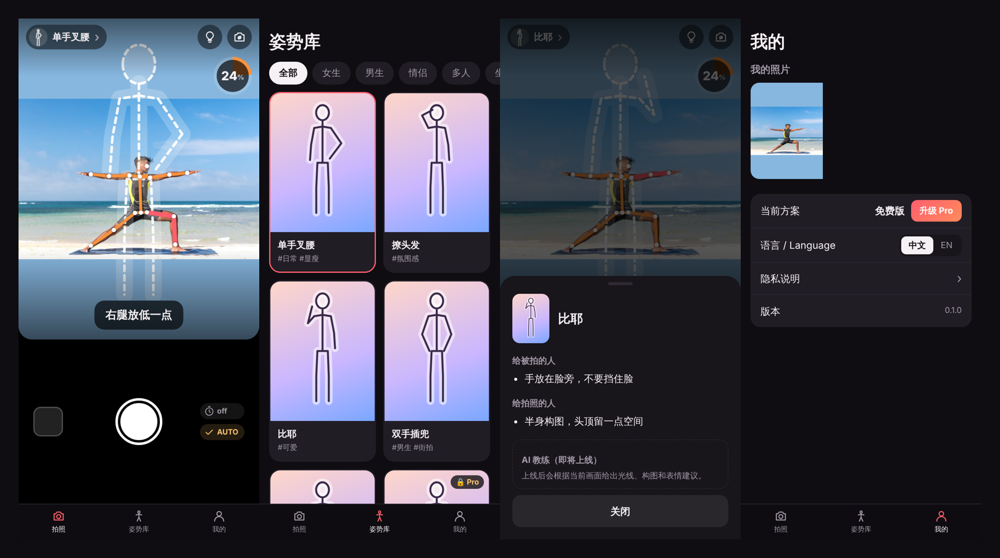

# 姿势搭子 PWA（PoseMate Web App）

iOS 版的网页版，核心链路已打通：**开相机 → 选姿势 → 跟着白色轮廓摆 → 看分数和提示调整 → 变绿自动拍/按快门 → 存到“我的”**。
纯静态、无构建步骤，可直接部署到 Vercel，手机上“添加到主屏幕”后像 App 一样全屏使用，断网也能打开和识别。



## 功能

| 功能 | 说明 |
| --- | --- |
| 实时姿势识别 | MediaPipe Pose Landmarker（lite），在浏览器里设备端运行，画面不上传 |
| 目标轮廓叠加 | 半透明身体剪影 + 白色虚线；自动选择左右镜像中更接近的一侧 |
| 匹配评分 + 提示 | 移植自 `ios/Packages/PoseKit` 的 `PoseMatcher`：8 个关节角按容差打分，≥85% 视为对上；给出最需要纠正的一条提示（如“右臂再弯一点”），并把那条肢体标红 |
| 拍照 | 3:4 原画质裁切；倒计时 off/3s/10s；“对上自动拍”（保持 1 秒自动按快门，一个人自拍也能用） |
| 姿势库 | 分类筛选（女生/男生/情侣/多人/坐姿…），Pro 姿势带锁 |
| 小贴士 | 每个姿势的“给被拍的人”“给拍照的人”提示 |
| 我的 | 照片存在本机 IndexedDB，可保存到相册（iOS 走分享面板“存储图像”）/分享/删除；中英切换；安装引导 |
| PWA | manifest、图标、Service Worker：外壳预缓存，模型首次使用后缓存，离线可用；发新版时提示刷新 |
| 占位 | 付费墙（“先免费体验（演示）”本地解锁）、AI 教练（即将上线） |

## 本地运行

```bash
cd pwa
npm run dev        # 或 python3 -m http.server 5173，然后打开 http://localhost:5173
npm test           # 匹配算法单元测试（Node 18+）
```

相机必须在 **HTTPS 或 localhost** 下才能用。手机真机调试：部署到 Vercel 预览地址最省事，或用 `npx localtunnel --port 5173` 之类的 HTTPS 隧道。

## 部署（GitHub Pages）

线上地址：**https://dayangcola.github.io/posemate/**

推送到 `main` 且 `pwa/` 有改动时，`.github/workflows/pages.yml` 会先跑测试，再把 `pwa/` 发布到 GitHub Pages（仓库 Settings → Pages 的 Source 需为 “GitHub Actions”）。发版时记得改 `sw.js` 里的 `VERSION`，用户才会收到“有新版本”提示。

所有路径都是相对路径，放在任何子路径下都能用；`vercel.json` 只是备用（想换 Vercel 时 Root Directory 选 `pwa`）。

> 国内访问：模型和 wasm 都自托管在 `vendor/`，不依赖 Google 的 CDN。`github.io` 在国内有时较慢或打不开，正式上线建议绑定自己的域名（或换国内 CDN/对象存储托管，同样是纯静态文件）。

## 目录

```
pwa/
├── index.html            单页：拍照 / 姿势库 / 我的 三个 Tab + 弹层
├── app.css               深色相机风格界面，品牌色沿用官网
├── js/
│   ├── app.js            路由、相机页指导逻辑（平滑分数、防闪烁提示、自动拍）、姿势库、我的、安装/更新
│   ├── matcher.js        PoseMatcher 移植 + MediaPipe 33 点 → 15 关节映射
│   ├── camera.js         getUserMedia、3:4 cover 裁切坐标换算、拍照
│   ├── detector.js       加载 MediaPipe（GPU 失败自动回退 CPU）
│   ├── overlay.js        画目标轮廓和实时骨架；姿势库 SVG 缩略图
│   ├── i18n.js           中英文案（中文优先）
│   └── store.js          IndexedDB 照片 + localStorage 设置
├── poses.json            与 iOS 共用的姿势模板（改动后两边同步）
├── sw.js                 Service Worker（发版时改 VERSION）
├── manifest.webmanifest  icons/
├── vendor/mediapipe/     @mediapipe/tasks-vision 0.10.21（Apache-2.0）+ pose_landmarker_lite 模型，约 15MB
├── tests/matcher.test.mjs
└── vercel.json
```

## 与 iOS 版的对应

- 模板坐标系一致：归一化、左上原点、3:4 竖画幅，提示里的左右指被拍者自己的左右。
- 关节：MediaPipe 没有 neck/root，取双肩/双髋中点，与 Apple Vision 对齐。
- 修了一个两边都有的问题：只露出一侧肢体时，非镜像比较可能完全没重叠而直接返回空，导致镜像匹配不生效。现在两边都算、取更好的那个（`PoseMatcher.swift` 也已同步修改）。

## 已知限制 / 下一步

- [ ] 情侣/多人姿势目前只识别一个人（`detector.js` 里 `numPoses: 1`），需要多人检测 + 按位置配对模板
- [ ] 模板目标轮廓位置固定；可以按用户实际身高/位置缩放对齐，更好跟
- [ ] 姿势内容只有 8 个示例，需要内容工具（上传参考图 → 提取骨架 → 导出 JSON）
- [ ] 网页订阅（Stripe / 微信支付等）和 AI 教练后端（多模态模型，Key 只放服务端）
- [ ] 照片只存在浏览器里，清除网站数据会丢；可加云相册
- [ ] 正式名、图标、隐私政策定稿；替换 `hello@example.com`
- [ ] 老设备（不支持 wasm SIMD，如 iOS 16.3 及以下）无法识别，仍可拍照
